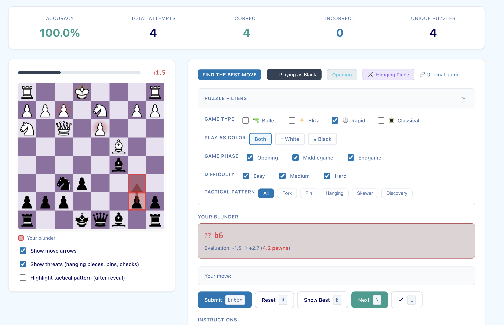
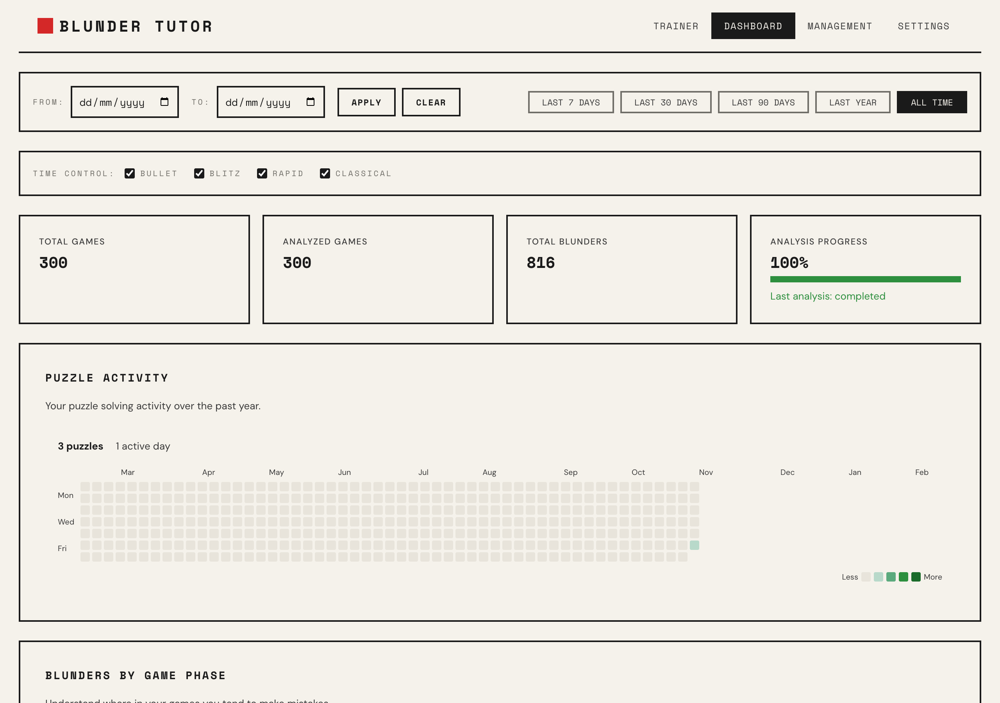
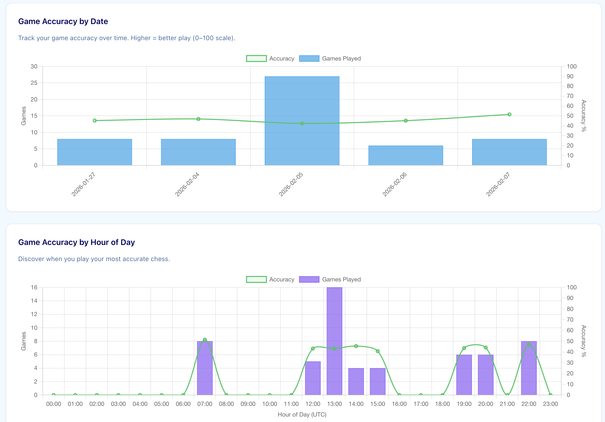
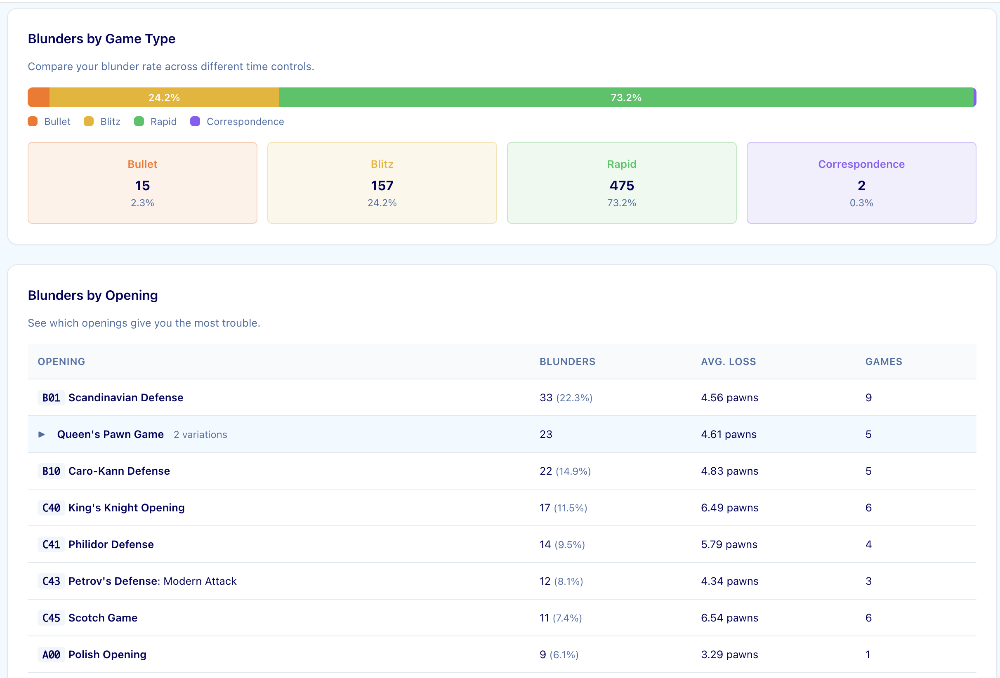
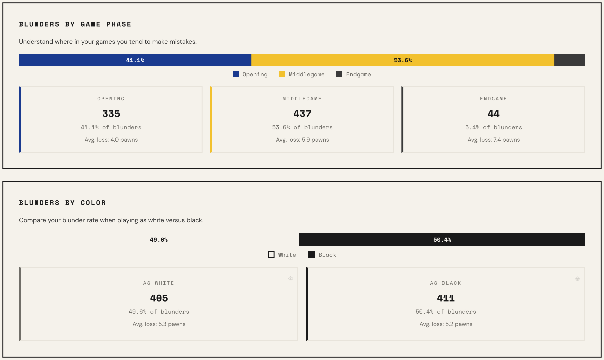
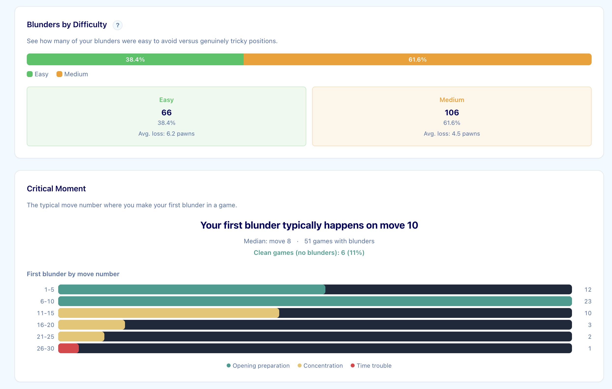
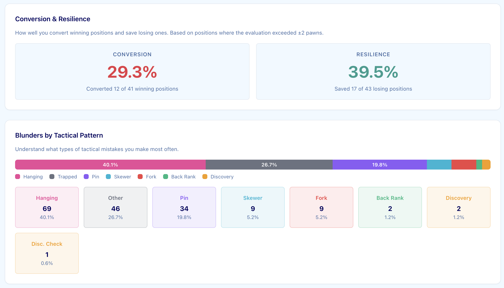
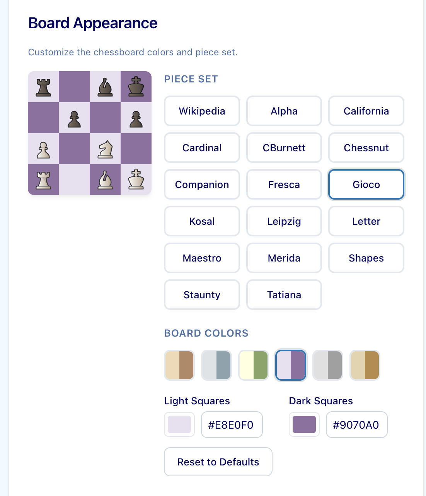

# Blunder Tutor

[](https://codecov.io/gh/MrLokans/chess-blunder-trainer) [](https://github.com/j178/prek)


**Stop repeating the same chess mistakes.** Blunder Tutor pulls your games from Lichess and Chess.com, finds the positions where you went wrong, and turns them into puzzles you can practice — for free, on your own machine.

**[Try the live demo →](https://blunders-demo.mrlokans.work/)**

**[The blog post with the design and approaches architecture](https://mrlokans.work/posts/building-self-hosted-chess-blunder-trainer/)**


## What It Does

1. **Import your games** from Lichess, Chess.com, or both
2. **Find your blunders** using Stockfish engine analysis
3. **Practice them as puzzles** — the positions where *you* made mistakes, not random tactics
4. **See where you're weakest** — dashboard shows your blunder patterns by opening, game phase, and difficulty

## Screenshots



| | |
|:-:|:-:|
|  |  |
|  |  |
|  |  |
|  | |

## Why Not Just Use Lichess or Chess.com Analysis?

- **Lichess analysis** shows you the blunder but doesn't let you drill it repeatedly
- **Chess.com Game Review** is paywalled — one free review per day, then $50–150/year
- **Generic puzzle sites** train random positions, not *your* weaknesses

Blunder Tutor combines the parts that matter: finds your mistakes, turns them into drillable puzzles, and tracks which patterns you've fixed. All free, all local.

## Quick Start

Requires [Docker](https://docs.docker.com/get-docker/) (check with `docker --version`). Stockfish is bundled in the image.

```bash
docker run -p 8000:8000 -v $(pwd)/data:/app/data ghcr.io/mrlokans/blunder-tutor:latest
```

On Windows PowerShell use `-v ${PWD}/data:/app/data` instead.

Open http://localhost:8000 and enter your chess username. Your games are then imported and analyzed in the background — this takes a while on the first run. The trainer shows an "Analyzing your games" screen and puzzles appear as analysis finishes; job progress is on the **Management** page.

For Docker Compose, environment variables, and advanced options see [Docker Deployment Guide](docs/DOCKER.md).

## Multi-User Mode (optional)

By default Blunder Tutor runs single-user with no login. To host multiple accounts on one instance, enable credentials mode:

```bash
docker run -p 8000:8000 -v $(pwd)/data:/app/data \
  -e AUTH_MODE=credentials \
  -e SECRET_KEY="$(openssl rand -hex 32)" \
  -e MAX_USERS=5 \
  ghcr.io/mrlokans/blunder-tutor:latest
```

First signup uses a one-time invite code printed to the server log on boot. Each account gets an isolated SQLite database under `data/users/`. See [Authentication](docs/AUTH.md) for the full setup, CLI admin commands, and gotchas.

## Configuration

All environment variables — auth, data, demo, engine, cache, analytics, observability (optional Sentry integration), debugging — are documented in [`docs/environment.md`](docs/environment.md).

## Features

- **Multi-platform import** — Lichess, Chess.com, or paste your own PGN
- **Stockfish analysis** — configurable depth, runs locally on your machine
- **Puzzle trainer** — practice your blunders with hints, best-move arrows, tactical patterns highlights and threat detector
- **Smart filtering** — narrow puzzles by game phase, tactical pattern, difficulty, time control, color, or date range
- **Spaced repetition** — recently solved puzzles are held back so you focus on fresh weaknesses
- **Opening traps** — see which traps you've fallen into and learn the refutations
- **Starred puzzles** — bookmark positions you want to revisit
- **Dashboard** — accuracy trends, activity heatmap, opening breakdown, phase/color/difficulty distribution, growth metrics, conversion & resilience rates, collapse-point analysis
- **Board & theme customization** — 16 piece sets, 6 board color presets, 7+ UI themes, or build your own
- **Auto-sync** — scheduled background fetch and analysis of new games
- **Self-hosted** — SQLite database, no external services, your data stays on your machine
- **Docker-ready** — single `docker run` command to get started
- **Multilingual** — English, Russian, Ukrainian, Spanish, Polish, Belarusian, and Chinese
- **Demo mode** — read-only hosted demo for trying the app without installing anything

## Local Development

### Prerequisites

| Tool | Version | Check | Install |
|---|---|---|---|
| [uv](https://docs.astral.sh/uv/) | any recent | `uv --version` | [docs.astral.sh/uv](https://docs.astral.sh/uv/getting-started/installation/) |
| Python | 3.14+ | `uv python find 3.14` | `uv python install 3.14` |
| Node.js | 22+ | `node -v` | [nodejs.org](https://nodejs.org) |
| Stockfish | any | `which stockfish` | `brew install stockfish` / `apt install stockfish` |

Stockfish is looked up only in `/usr/games`, `/usr/local/bin` and `/usr/bin` — **not** your `PATH`. If it lives elsewhere (e.g. Homebrew on Apple Silicon puts it in `/opt/homebrew/bin`), export `STOCKFISH_BINARY="$(which stockfish)"`.

### Setup

```bash
git clone https://github.com/MrLokans/chess-blunder-trainer.git
cd chess-blunder-trainer
make install-dev    # Python dependencies
npm ci              # Frontend dependencies
make build/fe       # Build frontend assets — required before the first run
make train-ui       # Start on http://localhost:8000
```

### Everyday commands

```bash
make test           # Run backend + frontend tests
make lint           # Check code style
make fix            # Auto-fix formatting
make help           # List all targets

# E2E tests
cd e2e && npm ci && npx playwright install && npx playwright test
```

### Common problems

- **`Unable to resolve the stockfish binary path`** — set `STOCKFISH_BINARY` (see Prerequisites).
- **Pages return 500 with `FileNotFoundError: .../static/dist/.vite/manifest.json`** — the frontend isn't built; run `npm ci && make build/fe`.
- **Port 8000 already in use** — `make train-ui PORT=8001`, or for Docker `-p 8080:8000`.
- **Trainer says "No puzzles available"** — import games first, or wait for analysis to finish (progress on the Management page).

Pre-commit hooks use [prek](https://prek.j178.dev/), configured in `prek.toml`.

## Contributing

Issues and pull requests are welcome. Follow [Local Development](#local-development) and run `make test` and `make lint` before submitting.

## Links

- [Changelog](CHANGELOG.md)
- [Docker Deployment Guide](docs/DOCKER.md)
- [Authentication](docs/AUTH.md) — multi-user mode setup and admin
- [Glossary](docs/GLOSSARY.md) — chess and engine terminology
- [License](LICENSE) (AGPL-3.0)
